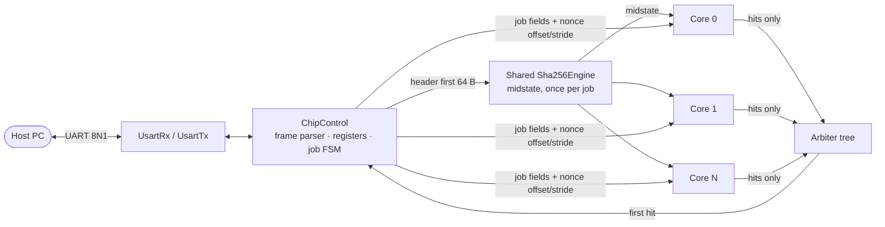
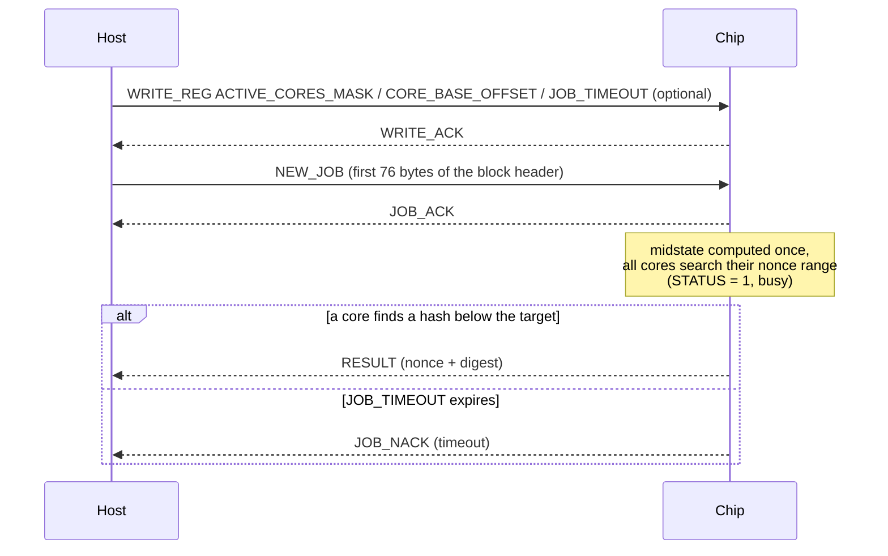

# ⛏️ minuscul_crypto_miner

**A Bitcoin mining ASIC architecture, designed and simulated cycle-accurately in Python with [py4hw](https://github.com/davidcastells/py4hw).**

Starting from a plain SHA-256 core, the design was taken step by step to a full multi-core mining chip with a UART control interface, and every step was benchmarked. The fully pipelined variant reaches **1 double-SHA-256 per clock cycle per core**.


---

## Highlights

| | |
|---|---|
| **SHA-256 core** | Self-timed pipeline (no central FSM), verified against `hashlib.sha256` |
| **Mining chip A** | 1–32 cores, shared midstate, per-core difficulty check, UART protocol |
| **Mining chip B** | Fully pipelined cores: a new nonce enters every cycle |
| **Throughput (chip B, 16 cores)** | **800 MH/s** at an assumed 50 MHz clock |
| **Verification** | Testbenches drive the chip only through its UART pins and check every digest against a software reference |

> ⚠️ All figures are **cycle counts from simulation** at an assumed 50 MHz clock. The design has not been synthesised; deeper round unrolling would lower the real achievable frequency.

---

## Architecture



**How it mines:** the host sends a block header over UART. The constant first 64 bytes are hashed **once** for the whole chip (the midstate). Each core then searches its own slice of the nonce space (offset + stride, so no two cores test the same nonce), runs the double SHA-256, and checks the result against the target locally. Only winning hashes travel to the arbiter tree, which reports the first one back to the host.

---

## Programming the chip

The chip has only three pins (`reset`, `uart_rx`, `uart_tx`) and is driven entirely over a UART link (8N1, baud rate = `f_clk / clks_per_bit`). The host sends framed commands; the chip answers with framed responses.



`PING` and `READ_REG` are answered in every state, including while mining. `ABORT_JOB` stops the search at any time; it has no reply, so the host polls `STATUS` until it reads idle before sending the next job.

<details>
<summary><b>Register map</b> (32-bit registers, read/written over UART)</summary>

| Address | Name | Access | Contents |
|---|---|---|---|
| `0x00` | `CHIP_ID` | R | fixed identifier, `0xB7C00001` (chip version 1) |
| `0x01` | `STATUS` | R | `0` idle · `1` busy (loading, running or draining) · `2` result pending · `3` error (last job timed out) |
| `0x02` | `NUM_CORES` | R | number of cores instantiated (fixed at build time) |
| `0x03` | `ACTIVE_CORES_MASK` | R/W | bit *i* enables core *i* for the next job; defaults to all ones |
| `0x04` | `CORE_BASE_OFFSET` | R/W | nonce offset added to every core, so several chips can share one job without overlapping |
| `0x05` | `JOB_TIMEOUT` | R/W | cycles to search before auto-abort and `JOB_NACK` (timeout); `0` disables it |

Registers can only be written while the chip is idle; a write during a job, or to a read-only or unknown address, gets `REG_NACK`.

</details>

<details>
<summary><b>Frame format and commands</b></summary>

**Frame (both directions):**

| Field | Size | Contents |
|---|---|---|
| `SOF` | 1 B | `0xAA`, start of frame |
| `CMD` | 1 B | command or response code |
| `LEN` | 2 B | payload length, big-endian |
| `PAYLOAD` | `LEN` B | command-specific body |
| `CHK` | 1 B | XOR of `CMD`, `LEN` and `PAYLOAD` |

A frame with a bad checksum, an unknown `CMD`, or that stalls for 20 character times is dropped silently; the host is expected to time out and resend.

**Host → chip:**

| `CMD` | Name | `LEN` | Payload |
|---|---|---|---|
| `0x01` | `NEW_JOB` | 76 | `header_first64bytes` (64) ‖ `merkle_tail` (4) ‖ `time` (4) ‖ `bits` (4); the target is derived from `bits` |
| `0x02` | `ABORT_JOB` | 0 | — |
| `0x03` | `PING` | 0 | — |
| `0x04` | `READ_REG` | 1 | `addr` |
| `0x05` | `WRITE_REG` | 5 | `addr` ‖ `value` (4) |

**Chip → host:**

| `CMD` | Name | `LEN` | Payload |
|---|---|---|---|
| `0x81` | `JOB_ACK` | 0 | — |
| `0x82` | `JOB_NACK` | 1 | reason: `0x01` malformed · `0x02` busy · `0x03` timeout · `0x04` no active cores |
| `0x83` | `RESULT` | 36 | `found_nonce` (4, header bytes 76–79) ‖ `found_digest` (32) |
| `0x84` | `PONG` | 0 | — |
| `0x85` | `REG_VALUE` | 5 | `addr` ‖ `value` (4) |
| `0x86` | `WRITE_ACK` | 1 | `addr` |
| `0x87` | `REG_NACK` | 1 | `addr` |

Codes and the `build_frame()` / `checksum()` helpers live in [`protocol.py`](minuscul_crypto_miner/architecture/bitcoinMining/bitcoinminingchip/protocol.py), shared by the hardware and the testbench. Full protocol details: [chip A README](minuscul_crypto_miner/architecture/bitcoinMining/bitcoinminingchip/README.md).

</details>

---

## Design journey

Every change was measured before moving on. Cycles per hash, per core:

| Step | Change | Cycles / hash | Gain |
|---|---|---|---|
| 1 | `Sha256CoreV1` baseline (single SHA-256) | 135 | — |
| 2 | Prefetch message-schedule words 2 rounds ahead in the compression loop | 72 | 1.9× |
| 3 | Mining chip, L1 = 2 words/cycle, L2 = 4 rounds/cycle (double SHA-256) | 28.2 | — |
| 4 | Per-core difficulty validator, so arbiters carry only hits | 28.2, now linear up to 32 cores | 1.77× aggregate |
| 5 | **Fused compressor**: schedule computed on the fly from a 16-word window | 16.8 | 1.67× |
| 6 | Bitcoin shortcuts: precompute rounds 0–2 once per job | 15.9 | — |
| 7 | **Chip B**: fully pipelined core, 4 rounds per stage, 33 stages | **1.0** | 16× |

Key design trade-offs, documented in the repo:

- **Fused vs. separate message schedule.** Computing `W[t+16]` inside the round loop, as real mining chips do, removed a 2,048-bit register buffer per hash stage and all its handshakes.
- **Round unrolling vs. clock frequency.** Chaining more rounds per cycle cuts cycle count but lengthens the critical path; chip B's `rounds_per_stage` (1/2/4) makes this trade-off a parameter.
- **Chip A vs. chip B cost.** For the same hashes per second, both need roughly the same round logic (~125 rounds), but chip B needs about half the registers (~26 kbit vs. ~48 kbit) and no per-core control logic. Rough estimate, not synthesised.

Detailed analyses:
[SHA-256 core](minuscul_crypto_miner/architecture/Sha256Crcuits/README.md) ·
[core performance notes](minuscul_crypto_miner/architecture/Sha256Crcuits/sha256_core_v1_perf_notes.md) ·
[chip A](minuscul_crypto_miner/architecture/bitcoinMining/bitcoinminingchip/README.md) ·
[chip A performance](minuscul_crypto_miner/architecture/bitcoinMining/bitcoinminingchip/performance_evaluation.md) ·
[chip B](minuscul_crypto_miner/architecture/bitcoinMining/BitcoinMiningChipB/README.md)

## Repository structure

```
minuscul_crypto_miner/
├── algorithms/          sha256.py: software reference model
├── architecture/
│   ├── Sha256Crcuits/       SHA-256 core and its stages
│   ├── bitcoinMining/
│   │   ├── miningengine/        midstate engine, nonce iterator, mining core
│   │   ├── bitcoinminingchip/   chip A + UART + ChipControl + protocol
│   │   └── BitcoinMiningChipB/  chip B, fully pipelined cores
│   ├── difficultyValidator/ nBits decoding and target compare
│   ├── bus/                 bus interfaces
│   └── seedGenerator/
└── implementation/      SystemVerilog rewrite (in progress)
test/components/         testbenches, benchmarks and animations per block
docs/                    background notes (e.g. survey of mineable coins)
```

---

## Getting started

```bash
git clone https://github.com/Kipa5577/minuscul_cripto_miner.git
cd minuscul_cripto_miner
pip install -e .            # installs py4hw and dependencies
```

Run a testbench or benchmark from its own folder (they import local test helpers):

```bash
cd test/components/tb_of_Sha256CoreV1
python tb_of_Sha256CoreV1.py          # checks digests against hashlib
python benchmark_Sha256CoreV1.py      # cycles per hash

cd ../tb_of_BitcoinMiningChip
python tb_of_BitcoinMiningChip.py     # full UART protocol test
python animation_of_BitcoinMiningChip.py   # live floorplan animation (matplotlib)
```

The animation draws the chip's floorplan and moves each nonce attempt as a coloured token through the stages, with winning hashes outlined in gold.

---

## Roadmap

- [x] SHA-256 core, verified
- [x] Multi-core mining chip with UART interface
- [x] Fully pipelined variant (chip B)
- [ ] SystemVerilog rewrite (started)
- [ ] FPGA prototype and synthesis results (real Fmax, area)
